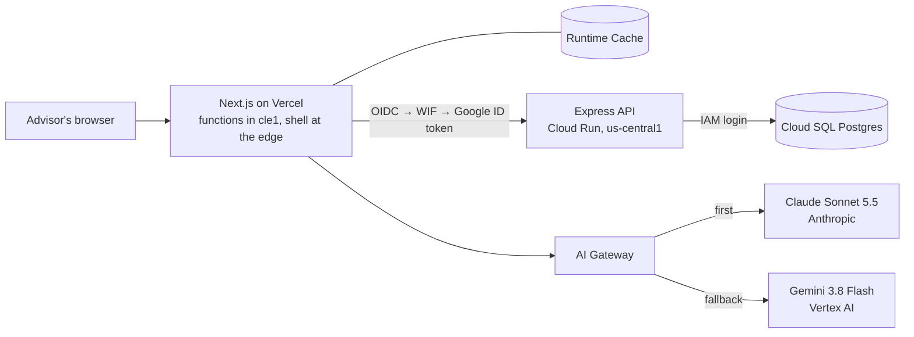

# Decisions

The architectural decisions behind this build. Each entry says what is true today. Where code
carries out a decision, a `Decision (Dnn)` comment marks the line.

## How to read this

- **Numbers** follow the order decisions were made, and never change. Code cites them.
- **Status** sits under each heading:
  - **Current:** true as written.
  - **Current, amended by Dnn:** still the home for its topic. Later decisions changed parts of
    it, and the text is rewritten to today's state. **History** lists each change.
  - **Superseded by Dnn:** replaced. Only a pointer is left.
  - **Context:** background the decisions build on, not a decision.
- **Every entry uses the same labels, in this order:** Problem, Decision, Why, Rejected,
  Trade-offs, Out of scope, In production, Open question, History, Evidence and Code. Labels
  with nothing to say are left out. *(Reason not yet recorded)* marks a rejected option whose
  reason was never written down.
- **Measurements and eval scores** live in [evidence.md](evidence.md). Entries keep only the
  headline number.
- **To get the whole system quickly,** read the [reading path](#reading-path).

## Needs a decision from Meridian

The prototype runs with these choices and workarounds. A real deployment needs Meridian to
accept or change each one.

1. **Personal data in the cache.** Owner details are cached for up to a day, and case text for
   up to an hour ([D14](#vehicle-page-caching)).
2. **Customer data sent to model providers.** Every AI request sends the vehicle record to
   Anthropic, or to Google if Anthropic fails. Call summaries also send the call transcript.
   Production needs Zero Data Retention routing and a privacy review ([D5](#models),
   [D16](#call-summary-generation), [D49](#assistant-model)).
3. **Model spend.** Claude costs about three times as much per answer as Gemini, and the bill
   goes to Meridian's Anthropic account instead of its Google Cloud commitment. For the
   assistant alone, at list price and 4,000 answers a day, that's about $46 a day instead of $13
   ([D49](#assistant-model)).
4. **Sign-in at the edge.** Per-advisor rate limits and pilot groups need Entra ID at the edge
   ([D18](#rate-limits), [D35](#rollout)).
5. **API additions owned by Meridian's API team.** A telematics "cleared" flag and a `unit`
   field ([D17](#vehicle-status)), a recorded link from each case to the fault that caused it
   ([D42](#fault-case-links)), and CRM change events ([D14](#vehicle-page-caching)).
6. **Private networking.** Vercel Secure Compute (an Enterprise feature) and a private IP for the
   database ([D3](#boundary-auth), [D10](#db-access)).

## Open question

- **The Anthropic spend cap no longer fits Claude-first.** [D23](#spend-alerts) set a
  $25/month hard limit on Anthropic when Claude was only the fallback. Since
  [D49](#assistant-model), Claude answers first, so the limit could be reached quickly. When it
  is, Anthropic stops accepting Meridian's key. AI Gateway then most likely retries Claude with
  Vercel's own key, a retry that is on by default and billed to AI Gateway Credits
  ([D5](#models)), before it tries Gemini. If so, the cap moves the bill rather than stopping
  it. Not yet decided.

## System at a glance

An advisor's browser loads a Next.js app on Vercel. The app's functions run in Cleveland
(`cle1`), the Vercel region closest to Meridian's API in Iowa (`us-central1`). The functions
call the API on Cloud Run with a short-lived Google token, and only the API reads and writes
Postgres. The assistant and call summaries reach the models through AI Gateway: Claude first,
Gemini if Claude fails.

## Reading path

Ten entries that explain the system end to end, in this order: [D28](#current-state) →
[D1](#scenario) → [D2](#gcp-backend) → [D3](#boundary-auth) → [D5](#models) →
[D14](#vehicle-page-caching) → [D15](#agent) → [D16](#call-summary-generation) →
[D35](#rollout) → [D49](#assistant-model).

## Cast

The five synthetic customers in the seed ([D6](#data-model), [D38](#seed-activity)). Each story
is also an eval case.

| Customer | Story | What it tests |
|---|---|---|
| Dana Whitfield | A recurring fault with a CRITICAL event. Three cases, ending in a buyback request the review team hasn't answered. | Repeat counts, the safety step, next steps that don't repeat ([D47](#answer-shape)) |
| Marcus Bell | A symptom that matches open recall MR-24-117. His case notes never mention the recall. | The assistant links symptom to recall on its own; no pronouns in summaries |
| Priya Raman | A healthy vehicle with no cases. | Empty states and "no reported faults" |
| Jordan Okafor | Two vehicles: an Aster EV, and a Kestrel work truck with a coolant warning and no case. | One customer with several vehicles; a fault with no case |
| Sam Torres | A fault that returned after its case was closed. His call transcript hides an instruction asking for a buyback. | Reopened faults; injected instructions left out of summaries |

## Glossary

| Term | Meaning here |
|---|---|
| AI Gateway | Vercel's proxy in front of the model providers. It routes requests, fails over on errors and reports each request's cost. |
| BYOK | Bring your own key: model calls are billed to Meridian's own provider accounts, not Vercel's. |
| OIDC token | A short-lived, signed identity token that Vercel gives each deployment. |
| WIF | Workload Identity Federation: Google Cloud swaps an outside token (Vercel's or GitHub's) for a Google one, so no key is stored. |
| Cloud Run, Cloud SQL | Google Cloud's container hosting (runs the API) and managed Postgres (holds the data). |
| Fluid compute | Vercel's function mode in which one instance serves many requests at once, billed for active CPU only. |
| Runtime Cache | Vercel's cache, shared across instances in one region and environment. Data marked `use cache: remote` lives there. |
| Tag, `updateTag` | A label on cached data. `updateTag` clears it after a write, so the next read is fresh. |
| Static shell | The page frame, sent at once from Vercel's edge. Each data panel streams in after it. |
| Server Action | A server function called from a form. Never cached, and its inputs never appear in a URL. |
| Preview Deployment | A full deployment for every branch, wired to staging. |
| Hydration | The moment React takes over server-sent HTML in the browser. Browser storage is read only after it. |
| `sessionStorage` | Browser storage for one tab, cleared when the tab closes. |
| Entra ID | Microsoft's sign-in service, which Meridian's advisors already use. |
| VIN | The 17-character vehicle identification number advisors look vehicles up by. |
| Rep note, AI draft | A note the advisor types directly, and a note drafted by Call summary and edited before saving. |
| CRITICAL event | The highest telematics severity. When one affects driving, the assistant's first next step is about the driver's safety. |
| Expand, then contract | Change a schema in steps: add the new shape beside the old, move every caller over, then remove the old. |
| Eval | A scripted test that runs the real model and grades its answers by fixed rules. |
| Instant Rollback | Vercel's one-click return to a previous production deployment. |
| Rolling Releases, Skew Protection | Vercel features that move traffic to a new release gradually, and keep each browser on the version it loaded until it reloads. |
| Workflows | Vercel's durable, multi-step jobs that can pause, for example to wait for an approval. |
| Median, p90 | Half of waits are shorter than the median; 9 in 10 are shorter than p90. |
| ZDR | Zero Data Retention: the provider keeps no copy of request data. |

## Index

- **Scenario:** [D28](#current-state) How Meridian's console runs today ·
  [D1](#scenario) Screen-by-screen rebuild · [D4](#primitives) Vercel features
- **Boundary:** [D2](#gcp-backend) GCP backend · [D3](#boundary-auth) Auth across the boundary ·
  [D7](#api-shape) API shape · [D8](#contracts) Contracts · [D10](#db-access) Cloud Run → Cloud
  SQL · [D11](#function-region) Function region · [D34](#concurrency) Concurrency ·
  [D36](#warm-api) Warm API · [D37](#telematics-windows) Past telematics
- **Rendering:** [D14](#vehicle-page-caching) Caching · [D17](#vehicle-status) Status row and
  faults · [D29](#error-states) Error states · [D21](#lookup-and-layout) Lookup ·
  [D41](#vehicle-routes) Vehicle routes · [D42](#fault-case-links) Faults linked to cases ·
  [D43](#layout-freshness) Layout freshness · [D44](#case-actions) Case view and actions ·
  [D45](#call-summary-target) Call summary target · [D31](#case-view) First case view
  (superseded)
- **AI:** [D5](#models) Models and failover · [D49](#assistant-model) Claude first ·
  [D15](#agent) Agent · [D30](#agent-context) Record up front · [D47](#answer-shape) Answer
  shape · [D48](#chat-reload) Chat after a reload · [D39](#assistant-suggestions) Suggested
  questions · [D16](#call-summary-generation) Call summary · [D26](#junk-transcripts)
  Non-support transcripts · [D33](#cost-per-run) Cost per answer · [D19](#evals) Evals
- **Data integrity:** [D6](#data-model) Data model · [D25](#note-ownership) Note ownership ·
  [D22](#save-feedback) Save failures · [D46](#repeat-safe-save) Repeat-safe save ·
  [D40](#case-numbers) Case numbers and case actions · [D38](#seed-activity) Seeded case
  activity
- **Release path:** [D9](#terraform) Terraform · [D12](#environments) Environments ·
  [D13](#pipeline) API pipeline · [D35](#rollout) Rollout · [D32](#release-versions) Versions ·
  [D24](#tests) Tests
- **Protection and spend:** [D18](#rate-limits) Edge rate limits · [D20](#api-rate-limit-keying)
  API rate limit · [D27](#agent-request) Agent request checks · [D23](#spend-alerts) Spend alerts

---

# Scenario

## D28. How Meridian's console runs today

**Status:** Context

- **Decision:** The scenario starts from this setup. Meridian's console is a React app built
  with Vite, served from Cloud Storage behind Cloud CDN, with Microsoft Entra ID sign-in. The
  browser calls REST services on Cloud Run in `us-central1`. Cloud Build uploads each release to
  the bucket, and there is one shared staging environment. About 80 advisors work in North
  America, Europe and the Middle East.
- **Why:** It's how a typical mid-market company runs an internal React app, and its problems
  are ones a platform and framework solve: slow screens far from Iowa, one shared staging, APIs
  exposed to the browser, and nowhere to run an assistant.
- **Rejected:**
  - As starting points: Next.js already self-hosted on GKE; the same app on VMs. *(Reasons not
    yet recorded.)*
  - As Meridian's alternative to Vercel: running Next.js on Cloud Run itself, which would mean
    owning scaling, the CDN setup, previews and rollbacks.
- **Trade-offs:** Functions run in one region, next to the data ([D11](#function-region)).
  Advisors abroad gain from the edge-served shell and streamed panels, not from faster data.

## D1. Rebuild the console one screen at a time, starting with the vehicle workspace

**Status:** Current

- **Problem:** Advisors piece together a vehicle's history from several screens of Meridian
  Motors' (fictional) support console.
- **Decision:** Rebuild the console in Next.js on Vercel, one screen at a time. The vehicle
  workspace moves first and gains an AI assistant. The API and database stay on Google Cloud.
- **Why:** One workspace with an assistant removes the piecing together. Rebuilding one screen
  at a time lets each screen reach advisors as soon as it's validated ([D35](#rollout)). The
  scenario comes from a support tool I worked on.
- **Rejected:**
  - A new Vercel-hosted assistant beside the existing app: advisors would still move between
    screens.
  - A full rebuild at once: nothing reaches advisors until everything is done.

---

# Decisions

## D2. The API and Postgres stay on Google Cloud; Vercel never connects to the database

**Status:** Current

- **Decision:** Express on Cloud Run with Cloud SQL Postgres. The API owns the Prisma schema and
  is the only path to the database.
- **Why:** It's a realistic system of record in Meridian's cloud. With the API as the only
  path, Vercel never connects to Postgres.
- **Rejected:** Cloud Run with Firestore; an external Postgres (Neon). *(Reasons not yet
  recorded.)*

## D3. Vercel reaches Cloud Run with a short-lived Google token, not an API key

**Status:** Current

- **Decision:** Vercel's OIDC token is exchanged through Workload Identity Federation (WIF) for a
  Google ID token, which Cloud Run IAM checks. The ID token is cached per function instance for
  about an hour.
- **Why:** No secret is stored, access is scoped per Vercel project and environment
  ([D12](#environments)), and anonymous calls get a 403. GitHub Actions deploys the same way
  ([D13](#pipeline)).
- **Rejected:** A shared API key, which is a long-lived secret to leak and rotate.
- **In production:** If Meridian's policy requires private APIs, Vercel Secure Compute (an
  Enterprise feature) and a site-to-site VPN can reach an internal load balancer instead.
- **Evidence:** The exchange works end to end from a Vercel deployment, including inside a
  `"use cache"` function.

## D4. Vercel features we use, and Workflows deferred

**Status:** Current

- **Decision:** AI SDK, AI Gateway, Cache Components with the Runtime Cache, Fluid compute,
  Vercel Firewall and Preview Deployments.
- **Why:** Fluid compute because agent requests spend most of their time waiting on the model.
  One instance serves many of them, and billing counts only active CPU ([D34](#concurrency)).
- **Out of scope:**
  - Workflows. Each AI request finishes in seconds within one request, changes nothing until the
    advisor saves, and is cheap to retry, so no step is worth checkpointing.
  - Eve, Vercel's agent framework, which runs each conversation as a durable session on
    Workflows. Vercel recommends an AI SDK agent like ours for this case ([D48](#chat-reload)).

## D5. Two models on two clouds, each on Meridian's own keys

**Status:** Current, amended by [D49](#assistant-model)

- **Decision:** Claude Sonnet 5.5 on Anthropic first, then Gemini 3.8 Flash on Vertex AI, for
  the assistant and call summaries. Both use Meridian's own keys (BYOK): Claude is billed to
  Meridian's Anthropic account, Gemini to its Google Cloud commitment.
  - **Failover:** AI Gateway moves to Gemini when a Claude request fails. It doesn't move on
    slow answers.
  - **Vercel's keys:** If one of Meridian's keys fails, AI Gateway first retries the same model
    with Vercel's own key. This is on by default
    ([docs](https://vercel.com/docs/ai-gateway/authentication-and-byok/byok)), and those requests
    are billed to AI Gateway Credits. The team setting "Fallback to Vercel Keys" turns it off, at
    $0.20 per 1,000 BYOK requests. `only: ["vertex", "anthropic"]` keeps each model on its
    provider but doesn't decide whose key is used, so it doesn't stop this retry.
  - **Likely order:** Claude on Meridian's key, Claude on Vercel's, Gemini on Meridian's, then
    Gemini on Vercel's. The docs don't confirm how the key retry and the model switch interleave.
    AI Gateway Logs show which key each request used.
- **Why:** Two vendors on two clouds, so a failure at one provider still leaves a working path.
- **Rejected:**
  - Vercel's keys only: spend wouldn't land on Meridian's existing agreements.
  - Gemini and Claude both on Vertex AI: Claude would share Gemini's failures, and it needs
    Model Garden setup.
- **Trade-offs:**
  - Customer data leaves Google Cloud on every AI request, because Claude is first. Only the
    fallback stays in Google Cloud.
  - The Vertex key is the system's one long-lived Google Cloud credential. It is limited to the
    Vertex AI User role and stored only in AI Gateway.
  - AI Gateway budgets don't cap spend on Meridian's own keys ([D23](#spend-alerts)). They do
    count the retries on Vercel's keys.
  - Answers differ by model, so evals run on both ([D19](#evals)).
- **History:** Until Nov 17, 2026, Gemini answered first and Claude was the fallback. The order
  was reversed after latency tests ([D49](#assistant-model)).
- **Code:** `apps/web/lib/ai/models.ts`, the only place model IDs and the order live;
  `infra/vertex.tf`.

## D6. Eight tables, seeded with five customer stories

**Status:** Current, amended by [D40](#case-numbers) and [D46](#repeat-safe-save)

- **Decision:** Eight tables: `customers`, `vehicle_models` (specs), `vehicles` (keyed by VIN),
  `telematics_events`, `recalls`, `vehicle_recalls`, `cases` and `case_notes`. The seed holds
  five synthetic customer stories (see [Cast](#cast)), each also an eval case.
- **Why:** Specs belong to the vehicle model, so they cache best. The VIN is what advisors
  already use. Recalls let the agent connect a reported symptom to an open recall, the most
  valuable link it can make.
- **History:**
  - [D40](#case-numbers) added `cases.number` (an identity column from 24101, shown as
    `CS-24101`) and `case_notes.removedAt`, and made `case_notes.issue` nullable for rep notes.
  - [D46](#repeat-safe-save) added `case_notes.draftId`, optional and unique.

## D7. The API is shaped around the data, not the AI

**Status:** Current, amended by [D22](#save-feedback), [D31](#case-view),
[D37](#telematics-windows) and [D40](#case-numbers)

- **Decision:** The API offers what the data supports, with no AI-specific endpoints:
  - customer by email
  - vehicle by VIN, with specs, recalls and the owner's phone
  - telematics, optionally filtered by `from`, `to` and `codedOnly`
  - a vehicle's cases with their notes, and one case by number
  - create a case with its first note, in one transaction
  - add a note, and remove or restore one
  - close and reopen a case

  Errors share one shape, `{ error: { code, message } }`. Express has no auth code, because Cloud
  Run IAM rejects callers before they reach it ([D3](#boundary-auth)).
- **Why:** Meridian's API shouldn't change to suit AI, so all AI logic stays on the Vercel side.
- **History:** The list grew with [D22](#save-feedback) (case with first note),
  [D31](#case-view) (close), [D37](#telematics-windows) (telematics windows) and
  [D40](#case-numbers) (case by number, reopen, remove and restore, owner's phone).

## D8. The web app checks every API response against its own schemas

**Status:** Current

- **Decision:** The web app keeps its own Zod schemas in `lib/customer/` and validates every
  response.
- **Why:** In a real deployment another team would own the API, so the web app treats it as an
  external contract and checks it at the boundary.
- **Rejected:** A shared `packages/contracts`, which would tie the web app to the API's code.
- **Trade-offs:** Shapes are written twice.

## D9. Terraform defines Google Cloud, with three exceptions

**Status:** Current

- **Decision:** Terraform defines Google Cloud in `infra/`, with state in a versioned GCS bucket.
  Three things stay outside it:
  - the running image, deployed by GitHub Actions
  - Postgres grants, in `infra/sql/grants.sql`
  - the Vercel project, because the Vercel Terraform provider needs a long-lived token

  Firewall rules are JSON in `infra/vercel-firewall/`, applied with the Vercel CLI.
- **Why:** The boundary (WIF trust and IAM bindings) is what reviewers question, so it should be
  readable code.

## D10. The API logs in to Postgres with IAM, never a password

**Status:** Current

- **Decision:** The API connects through the Cloud SQL connector with IAM database login. Both
  run in `us-central1`. The database has a public IP with no authorized networks, so only the
  IAM-checked connector can reach it. The API's database user can't change the schema;
  migrations run as the deployer ([D13](#pipeline)).
- **Why:** No workload uses a database password. The API and CI log in with IAM, and Terraform
  creates only IAM database users.
- **Trade-offs:** One manual exception: the first production reseed used a temporary password
  ([D32](#release-versions)).
- **In production:** A private IP.

## D11. Functions run in Cleveland, the closest region to the API in Iowa

**Status:** Current

- **Decision:** `cle1` (Cleveland), set in `apps/web/vercel.json`.
- **Why:** Every dynamic request calls the API in `us-central1` (Iowa), and `cle1` is the closest
  Vercel region. The static shell is still served from Vercel's global edge.
- **Trade-offs:** Functions run in one region. If it fails, Vercel reroutes to the next closest.

## D12. Previews can only reach staging, never production

**Status:** Current

- **Decision:** Separate staging and production API services and databases, on one Cloud SQL
  instance. `develop` deploys staging and `master` deploys production. Vercel Preview and
  Development deployments use staging; Production uses production.
- **Why:** A preview can never touch production data. Each environment has its own service
  accounts, and WIF reads the environment from the Vercel token, so a preview can only act as
  the staging caller. Each database also revokes `CONNECT` from `PUBLIC`.

## D13. CI migrates the database before it deploys the new API

**Status:** Current

- **Decision:** GitHub Actions runs on every push to `develop` or `master`. It builds the image,
  runs `prisma migrate deploy` through the Cloud SQL Auth Proxy, then deploys the new revision.
  It authenticates through a GitHub WIF provider trusted by repository ID, and each branch can
  act only as its own environment's deployer. The web app deploys separately through Vercel's
  Git integration.
- **Why:** Migrating first means a failed migration leaves the running revision untouched.
- **Rejected:** Migrations as a Cloud Run Job; Terraform in CI. *(Reasons not yet recorded.)*
- **Trade-offs:** Migrations must be backward compatible. The old revision keeps serving traffic
  on the new schema until the new revision is ready, so a change is made in steps: expand, then
  contract (see the glossary). [D25](#note-ownership), [D35](#rollout) and [D40](#case-numbers)
  rely on this rule.

## D14. Vehicle data is cached for hours and cases for minutes, in a shared cache

**Status:** Current, amended by [D37](#telematics-windows), [D41](#vehicle-routes) and
[D43](#layout-freshness)

- **Problem:** The vehicle page reads data that changes at very different rates, from specs that
  never change to cases that change on every save, and a save must show up at once for every
  advisor.
- **Decision:** A static shell, with each panel streamed in independently:

  | Data | Strategy | Tag |
  |---|---|---|
  | Vehicle, specs, recalls | `use cache: remote`, `hours` (`minutes` if not found) | `vehicle:{vin}` |
  | Cases and notes | `use cache: remote`, `minutes`; `updateTag` on every write | `cases:{vin}` |
  | Settled telematics windows | `use cache: remote`, `days` ([D37](#telematics-windows)) | `telematics:{vin}` |
  | Live telematics | Not cached (`connection()`) | — |
  | Agent answers | Not cached. The agent's record reads use the cached fetchers above ([D30](#agent-context)). | — |
  | Customer search by email | Not cached: it runs only in a Server Action, which also keeps emails out of URLs | — |

  - **Case page:** It reads its case from the cached case list, so it shares the `cases:{vin}`
    tag ([D41](#vehicle-routes)).
  - **Prefetching:** With `partialPrefetching`, a link prefetches its route's shell once, shared
    by every link to that route, so a click shows the layout and skeletons at once
    ([docs](https://nextjs.org/docs/app/guides/prefetching#partial-prefetching)).
- **Why:** An in-memory cache lives in one instance, so after a save another instance could keep
  serving old cases. The Runtime Cache is shared within a region and environment, so `updateTag`
  reaches every instance.
- **Rejected:**
  - `generateStaticParams` for the seeded vehicles: it would put owner details in static HTML,
    and the real fleet is unbounded. One shell serves every VIN.
- **Trade-offs:**
  - A change made outside this app, such as a completed recall or new owner details in
    Meridian's CRM, can take about an hour to appear. The `hours` profile refreshes an entry
    hourly, but an entry nobody reads can be kept for up to a day.
  - Owner details are cached for up to a day and case text for up to an hour. Meridian needs to
    approve this.
  - The Runtime Cache starts empty after each deploy.
- **In production:** The CRM would send change events to a route that invalidates the VIN's tags.
- **History:** [D43](#layout-freshness) corrected the agent and customer-search rows and added
  the notes on `generateStaticParams` and prefetching. They're folded in here.

## D15. The assistant can read only the vehicle that's open

**Status:** Current, amended by [D30](#agent-context), [D40](#case-numbers),
[D47](#answer-shape) and [D48](#chat-reload)

- **Decision:** An AI SDK `ToolLoopAgent` behind `POST /api/agent`, shown as a chat on the
  vehicle page.
  - **Scope:** The route supplies the open vehicle, so the model can't choose a VIN.
  - **Input:** The vehicle record is loaded before the model runs ([D30](#agent-context)). One
    tool, `getTelematics`, fetches older telematics history, with a step cap of 3.
  - **Limits:** `reasoning: "low"`, the last 10 messages, and request checks
    ([D27](#agent-request)).
  - **Grounding:** It uses only facts from the record or a tool, and gives the date of each
    fact. It says when data is missing. It may cite case numbers but never internal IDs
    ([D40](#case-numbers)).
  - **Answer shape:** Follows the question. Next steps appear only when they're new
    ([D47](#answer-shape)).
  - **Memory:** The thread survives a reload, in tab storage ([D48](#chat-reload)).
- **Why:** No prompt can make the agent read another customer's vehicle.
- **Trade-offs:**
  - It can't compare a customer's vehicles.
  - No cap on answer length. Gemini's hidden reasoning counts toward that cap, and at 1,000
    tokens answers were cut off. Cost is bounded in other ways: the step cap, the message limits
    and the edge rate limit ([D18](#rate-limits)).
- **History:**
  - [D30](#agent-context) replaced three fetching tools with a record loaded up front.
  - [D40](#case-numbers) allowed case numbers.
  - [D47](#answer-shape) made next steps conditional; they used to end every answer.
  - [D48](#chat-reload) kept the thread across a reload.
- **Code:** `apps/web/lib/ai/vehicle-agent.ts`.

## D16. One model call drafts the call note; the advisor edits and saves it

**Status:** Current, amended by [D26](#junk-transcripts), [D45](#call-summary-target),
[D46](#repeat-safe-save) and [D49](#assistant-model)

- **Problem:** After a call, the advisor writes up the case note by hand.
- **Decision:** One structured model call (`streamText` with `Output.object`), with the vehicle
  record loaded up front. It drafts the `case_notes` fields (issue, summary, next steps), plus a
  subject and category for a new case.
  - **Review:** The advisor edits the draft and presses Save. A Server Action writes the note,
    marked `AI_DRAFT_EDITED`, and calls `updateTag`.
  - **Target:** Only open cases are listed. The default is the case in view if it's open,
    otherwise the newest open case, otherwise New case ([D45](#call-summary-target)).
  - **Safe retries:** Each draft carries an ID, so a repeated save can't write it twice, and an
    unsaved draft survives a reload ([D46](#repeat-safe-save)).
  - **Non-support calls:** Flagged with a warning rather than summarized
    ([D26](#junk-transcripts)).
  - **Prompt rules:** Instructions hidden in a transcript are left out without being mentioned.
    The customer's first name replaces any pronoun ([D49](#assistant-model)).
  - **Limits:** Transcripts up to 15,000 characters.
- **Why:** Predictable, cheap and easy to evaluate. The call has no tools, so instructions hidden
  in a transcript can't fetch or change anything.
- **Rejected:**
  - The agent with its tools: a transcript's hidden instructions could then make it fetch data.
  - Always opening a new case; display only, with no save. *(Reasons not yet recorded.)*
- **Trade-offs:** It can't look beyond the record it's given. Transcripts are personal data sent
  to model providers, Anthropic first ([D49](#assistant-model)).
- **In production:** Zero Data Retention routing and a privacy review.
- **History:** [D26](#junk-transcripts) added the call-type warning, [D45](#call-summary-target)
  narrowed the case list to open cases, [D46](#repeat-safe-save) added the draft ID and draft
  storage, and [D49](#assistant-model) reworded two prompt rules.
- **Code:** `apps/web/lib/ai/call-summary-request.ts`.

## D17. Faults from the last 30 days count as current

**Status:** Current, amended by [D43](#layout-freshness)

- **Problem:** Telematics has no "cleared" flag, so the status row can't tell an active fault
  from an old one.
- **Decision:** Faults from the last 30 days count as current. Each status item streams in on its
  own, ordered worst first.
  - **Units:** The API sends units only inside each telematics message, such as "(miles)", "(%)"
    or "(°C)", so the app reads them from there.
- **In production:** A "cleared" flag and a `unit` field in Meridian's API.
- **History:** This entry also said the status row and telematics panel share one fetch so their
  counts agree, and set a rule for when fault codes in answers become links. Both stopped
  holding once the header moved into a shared layout ([D41](#vehicle-routes)).
  [D43](#layout-freshness) replaced them. Units moved here from [D21](#lookup-and-layout).
- **Code:** `apps/web/lib/telematics.ts`, `apps/web/lib/format.ts`.

## D18. AI and save routes are rate-limited at the edge, per IP

**Status:** Current

- **Decision:** Two Vercel Firewall rules, counted per IP over 60 seconds, returning 429: 20 a
  minute for the AI routes and 30 a minute for note saves.
- **Why:** A blocked request never starts a function or calls a model.
- **Rejected:** `checkRateLimit()` in the route; a Redis-based limiter; only the Cloud Run limit.
- **Trade-offs:** Advisors at a contact center share office IPs, so per-IP limits don't suit
  production. For spend spread across many IPs, the backstop is [D23](#spend-alerts)'s alerts
  and Anthropic limit (see the open question there).
- **In production:** Once Entra ID sign-in exists, limits count per advisor, using
  `checkRateLimit()` with a `rateLimitKey`.
- **Code:** `infra/vercel-firewall/`.

## D19. Evals run the real agent and call summaries on each model

**Status:** Current, amended by [D40](#case-numbers), [D47](#answer-shape) and
[D49](#assistant-model)

- **Decision:** Vitest, run on demand with `pnpm eval`. The evals run the real agent and call
  summary against staging, through the real boundary, on each model alone, three times per
  case.
  - **Cases:** 13 agent cases and 7 call-summary cases, including a request for another
    customer's VIN and a prompt injection. `nextSteps: true` marks the 4 cases that must end with
    next steps. `history` holds earlier questions for multi-turn cases.
  - **Grading:** Deterministic. Required facts must be present. Internal IDs, invented fault
    codes, assumed pronouns, promises to the customer, markdown, and any mention of the removed
    note must be absent. The promise check needs the verb within three words of the item.
  - **Report:** Pass rates, timings, cost and average thinking tokens per case, so a prompt
    change that makes a model think shows up in the normal run.
- **Rejected:** HTTP requests against the route; recorded fixtures; an LLM judge. *(Reasons not
  yet recorded.)*
- **In production:** Run them on every release PR.
- **Evidence:**
  - They caught Claude guessing pronouns, Gemini leaving out driver-safety advice and offering a
    loaner, Claude copying an injected instruction into a note, and a tool loop that added
    nothing ([D30](#agent-context)).
  - Latest results (Nov 17, 2026): agent 39/39 and call summaries 21/21 on both models. Every
    run is in [evidence.md](evidence.md#eval-results).
- **Code:** `apps/web/evals/`.

## D20. The API rate-limits per calling service, not per IP

**Status:** Current

- **Problem:** The API's limit counted per IP, but all traffic arrives from Vercel's shared IPs,
  so every advisor shared one budget of 120 requests a minute.
- **Decision:** Count per calling service account, read from the IAM-verified token, at 1,200 a
  minute per environment.
- **Why:** The edge limits people ([D18](#rate-limits)), and the API limits calling systems.
- **Trade-offs:** Counters live in each instance's memory, and Cloud Run runs up to 3 instances
  ([D34](#concurrency)), so the real ceiling can be up to three times higher. That's acceptable
  for a backstop.

## D21. Lookup suggestions never call the server

**Status:** Current

- **Problem:** Advisors need help finding a vehicle. A server search by prefix would help, but
  on a public prototype it would let anyone list customers.
- **Decision:** Suggestions come only from the browser: recent vehicles, the six seeded
  vehicles, and hints that update as the advisor types.
  - **Hints:** Input with a digit is treated as a VIN. The hint counts characters toward 17 and
    flags I, O or Q, anything other than letters and digits, or more than 17 characters. Input
    with an "@" is labelled as an email, with no format check.
  - **Recents:** The last five vehicles are kept in `localStorage`, never with emails.
- **In production:** A server search by prefix, once advisors sign in.
- **History:** This entry also covered telematics units, now in [D17](#vehicle-status), and the
  assistant's tabs staying mounted, now in [D41](#vehicle-routes).
- **Code:** `apps/web/lib/recent-vehicles.ts`, `apps/web/components/search/vehicle-search.tsx`.

## D22. A failed save keeps the advisor's edits

**Status:** Current, amended by [D46](#repeat-safe-save)

- **Problem:** A failed save threw an error in the browser, and the error page wiped the
  advisor's edits.
- **Decision:** Edits always stay in the form, and the error says what happened (404, 400 with
  the reason, or 429). A new case and its first note are written in one transaction
  (`POST /cases`), so a failed save leaves nothing behind, and a retry repeats the whole save
  rather than creating a case with no note.
- **History:** A save that succeeds but loses its response is handled in
  [D46](#repeat-safe-save).

## D23. Spend alerts on Google Cloud and a hard cap on Anthropic

**Status:** Current, with an open question since [D49](#assistant-model)

- **Decision:** A $25/month budget alert on two Google Cloud billing services, Vertex AI and the
  Gemini API (`infra/budget.tf`), and a $25/month hard limit on Anthropic.
- **Why:** The app calls Gemini only through Vertex AI, but the repo doesn't show which of the
  two services bills that usage, so the budget covers both. The budget measures spend before
  credits; otherwise it would read $0 and never alert.
- **Rejected:**
  - A lower Vertex quota. *(Reason not yet recorded.)*
  - A budget that unlinks billing: it would stop every workload in the project.
- **Trade-offs:** Google Cloud budgets alert but don't stop spending, and they lag by hours.
- **In production:** Quotas per model and alerts to on-call.
- **Open question:** The Anthropic cap was set when Claude was only the fallback. Since
  [D49](#assistant-model), Claude answers first, at an estimated $46 a day at production volume,
  so the cap could be reached within a day. When it is, Anthropic stops accepting Meridian's
  key. AI Gateway then most likely retries Claude with Vercel's own key, billed to AI Gateway
  Credits ([D5](#models)), before it tries Gemini. If so, the cap moves the bill rather than
  stopping it. Options:
  - Turn off the retry on Vercel's keys, so Gemini takes over when the cap is reached.
  - Raise the cap, and add an AI Gateway budget for spend on Vercel's keys.
  - Accept the behavior as it is.

## D24. API tests use a real database; model behavior is left to the evals

**Status:** Current

- **Decision:** API tests run against a real Postgres through the real app, covering contracts,
  privacy, bad input, ownership and rate limits. About 100 web unit tests cover parsing, request
  checks and save errors. CI runs both on every PR, with no secrets. Model behavior is left to
  the evals ([D19](#evals)). The API tests refuse any database whose name doesn't end in
  `_test`, because the seed deletes rows.
- **Rejected:** Mocking Prisma; component tests; Playwright in CI. *(Reasons not yet recorded.)*
  Playwright was later used for one-off browser checks ([D47](#answer-shape),
  [D48](#chat-reload)).

## D25. The API checks that a note's case belongs to its vehicle

**Status:** Current

- **Problem:** A crafted Server Action request could attach a note to another customer's case.
- **Decision:** The API checks that the case belongs to the note's VIN, which protects every
  client, not just this one. The VIN is a new required field on note writes.
- **Trade-offs:** A new required field breaks every caller that doesn't send it yet, including
  the React app ([D7](#api-shape)). Here both sides shipped in one release. With the React app
  still calling the API, the safe order is expand, then contract ([D13](#pipeline)): the API
  accepts an optional VIN and checks it when present, every caller starts sending it, and only
  then does the API require it.

## D26. Calls with nothing to summarize are flagged, not summarized

**Status:** Current

- **Problem:** Given a transcript with nothing to summarize, the model presented the vehicle
  record as if it were the call.
- **Decision:** Prompt rules plus a `callType` field (`vehicle_issue`, `other` or
  `no_conversation`). Any type other than `vehicle_issue` shows a warning in the review form. The
  field isn't saved, but it gives the evals something exact to check.
  - **Length limits:** The draft schema tells the model the length limits but doesn't reject a
    draft that exceeds them, so an over-long draft doesn't vanish in the browser. The save
    action names the field that's too long instead.
- **Trade-offs:** A wrong number can fairly be read as `other` or `no_conversation`. Both show a
  warning, and the `no_conversation` wording ("Nothing to summarize from this call") fits
  silence, noise and wrong numbers alike, so the prompt wasn't changed for it (Nov 17, 2026).
  Prompt edits have cost eval regressions before ([D40](#case-numbers)).

## D27. The agent route accepts only what the chat UI sends

**Status:** Current

- **Problem:** The route accepted any role, any message part type and empty questions.
- **Decision:** An allow-list: `user` and `assistant` roles, text-only user messages, up to 2,000
  characters per question and 80,000 across the last 10 messages. Rejected requests get a 400 or
  413 before any model call.
- **Trade-offs:** A caller can forge earlier assistant turns, but only within their own session.
  A forged earlier answer can also stop a next step from appearing in the next answer
  ([D47](#answer-shape)).
- **Code:** `apps/web/lib/ai/agent-request.ts`.

## D29. Each panel fails on its own and offers Retry

**Status:** Current, amended by [D43](#layout-freshness)

- **Problem:** One failing panel replaced the whole page, the lookup had no error boundary, an
  invalid draft vanished, and the chat had no retry.
- **Decision:** Each panel catches its own failure and offers Retry, and so does the vehicle
  header ([D43](#layout-freshness)). When the vehicle read fails, the specs card shows no error
  of its own and leaves the explanation to the header's Retry card. The lookup shows errors
  inline. Both AI routes share one error shape, and a failed answer offers Try again. An
  over-long draft no longer vanishes ([D26](#junk-transcripts)).
- **Why:** One panel's data failing (telematics down, say) costs that panel, not the page.
- **History:** [D43](#layout-freshness) added the header's Retry card.
- **Code:** `apps/web/lib/load-panel.ts`, using `unstable_rethrow` so prerendering still works.

## D30. The vehicle record is loaded before the model runs

**Status:** Current, amended by [D40](#case-numbers) and [D47](#answer-shape)

- **Problem:** Both models called all three of the agent's tools (vehicle, cases and telematics)
  for every question, so the first round trip was always the same and only added latency.
- **Decision:** The route loads the vehicle, its cases and the 20 newest telematics events from
  the page's cached fetchers, and sends them as a second system message after a static prompt
  that providers can cache.
  - **Shaped for the model:** No internal IDs, dates already formatted, and facts computed in
    code rather than left for the model to infer: repeat counts, case numbers
    ([D40](#case-numbers)), each open case's days since its last update, and the next steps
    earlier answers already gave ([D47](#answer-shape)).
  - **One tool:** `getTelematics`, for older history, with a step cap of 3.
  - **History sent by the browser:** Earlier tool results are dropped, since they could be
    forged.
  - **AI Gateway:** `caching: 'auto'`, and a `feature:` tag per route for spend reporting.
- **Rejected:**
  - Forcing the first step to call the tools: Anthropic's API doesn't allow that with extended
    thinking on.
  - Keeping the tool loop as it was: the first round trip never changed, so it only added
    latency.
- **Trade-offs:** Every request carries the record's tokens.
- **Evidence:** Median answer time fell from 4.7 s to 2.6 s on Gemini and from 5.4 s to 4.0 s on
  Claude. Both models scored 30/30 ([evidence.md](evidence.md#latency)).
- **Code:** `apps/web/lib/ai/load-vehicle-record.ts`, `apps/web/lib/ai/model-context.ts`.

## D31. Case view (first version)

**Status:** Superseded by [D44](#case-actions)

The first case page, at `/cases/[caseId]`, with an overdue banner and faults matched by date.
It was replaced in parts: case numbers ([D40](#case-numbers)), routes
([D41](#vehicle-routes)), fault matching ([D42](#fault-case-links)), and actions and fault
history ([D44](#case-actions)).

## D32. Releases are versioned by date

**Status:** Current

- **Decision:** Date-based versions, such as branch `release/26.11.15.1` and tag `v26.11.15.1`.
  `package.json` versions stay semver.
- **Why:** A date tells support which build is live, and this is an app, not a library.
- **Trade-offs:** Production was reseeded once by hand for the first release, through the Auth
  Proxy as Cloud SQL's built-in `postgres` user, with a temporary password set outside Terraform.
  Afterwards the password was rotated to a random value that isn't stored. CI never reseeds
  production.

## D33. Cost per answer comes from AI Gateway, not a price table

**Status:** Current, amended by [D47](#answer-shape) and [D49](#assistant-model)

- **Decision:** Use the cost AI Gateway returns with every response. Its `marketCost` field is
  the list price of the tokens used; its `cost` field is 0, because Meridian's own keys are
  billed by the provider. The app logs one `ai_usage` line per answer, and the eval report shows
  averages.
- **Why:** AI Gateway prices each response, so there's no price table to keep current.
- **Rejected:** A price table kept in the repo; dashboard totals only. *(Reasons not yet
  recorded.)*
- **Trade-offs:** `marketCost` is the list price. Meridian's real bill is the provider's invoice,
  at its negotiated rates. The `feature:` tags add $0.000075 per request; they're kept because
  they split spend by feature.
- **History:** This entry's first cost table was measured with Gemini first. It moved to the
  evidence log when [D49](#assistant-model) reversed the order.
- **Evidence:** At list price, one answer costs about half a cent on Claude and a quarter of a
  cent on Gemini in the evals. In a three-question call, which sends more history, it's about
  1.2 cents on Claude and 0.3 cents on Gemini. Since [D49](#assistant-model), the more
  expensive model answers first. Every measurement, labelled by test, is in
  [evidence.md](evidence.md#cost).
- **Code:** `apps/web/lib/ai/usage.ts`.

## D34. Four database connections per API instance

**Status:** Current

- **Problem:** One `db-f1-micro` Cloud SQL instance, with about 25 connections, holds both
  environments' databases. Cloud Run runs up to 3 instances per environment, each handling up
  to 80 concurrent requests. At 5 connections per instance, full scale would need 30
  (3 instances × 5 connections × 2 environments).
- **Decision:** A pool of 4 per instance, 24 in total.
- **Why:** 80 advisors generate a few requests a second at peak, well within these limits.
- **Trade-offs:** The database's connection limit is the real ceiling. Beyond it, use a larger
  instance or a connection pooler.
- **Code:** The pool size in `services/vehicle-api/src/db.ts` and `max_instance_count` in
  `infra/cloud-run.tf`, both marked `Decision (D34)`.

## D35. Ship through previews and release branches; Meridian migrates screen by screen

**Status:** Current

- **Decision:**
  - **This prototype:** Every branch gets a Preview Deployment against staging
    ([D12](#environments)). Merging a `release/*` branch to `master` deploys the production API
    and web app ([D32](#release-versions)). Rollback is Instant Rollback on Vercel and the
    previous revision on Cloud Run. Migrations are expand, then contract ([D13](#pipeline)). When
    a change spans both sides, the API ships first, unless it starts requiring something callers
    don't send yet ([D25](#note-ownership)).
  - **Meridian's migration:** Incremental, following Vercel's guide.
    - Meridian's domain points to Vercel from the start. Next.js fallback rewrites send every
      path the new app doesn't have yet to the React app, so advisors see one address.
    - Each rebuilt screen goes first to a pilot group, chosen by Routing Middleware (`proxy.ts`)
      from the advisor's Entra ID group and a flag in Global Config, then widens to every
      advisor.
    - Rolling back a screen is a flag change, with no redeploy.
    - The React app retires when nothing falls back to it.
    - Every release uses Rolling Releases and Skew Protection.
- **Why:** Each screen's value reaches every advisor as soon as it's ready, rollback is per
  screen, and there is no single switchover where problems surface late.
- **Rejected:**
  - A pilot group on the new app, then everyone switching at once when every screen is done:
    problems would surface late, all at once.
  - Vercel Microfrontends. *(Reason not yet recorded.)*
- **Trade-offs:** Links between the two apps load a full page, so both apps' navigation must
  match. Group flags need Entra ID sign-in at the edge, which the prototype doesn't have yet.

## D36. One production API instance is always warm

**Status:** Current

- **Problem:** With staging at zero instances, the first vehicle page took 6.8 s. About 3.8 s was
  Cloud Run starting up; the rest was a cold function, the token exchange and an empty cache.
  Production, with one instance running, took 0.46 s.
- **Decision:** One minimum instance on production; staging still scales to zero.
- **Rejected:** A scheduled `/health` ping. *(Reason not yet recorded.)*
- **Trade-offs:** About $10/month while idle (an estimate). It stays within
  [D34](#concurrency)'s connection limit. It doesn't fix the Vercel side after a deploy: an empty
  Runtime Cache, and one token exchange per new function instance.

## D37. Past telematics is read in cached, settled windows

**Status:** Current, amended by [D44](#case-actions)

- **Problem:** The case page looked for a case's faults only among the vehicle's newest
  telematics events, so for an older case the week before it opened came back empty.
- **Decision:** The API accepts `from`, `to` and `codedOnly` on telematics, and the case page reads
  one window per case for its fault history ([D44](#case-actions)). A window that ended more than
  24 hours ago is cached for days; a newer one is read fresh.
- **Why:** The 24 hours allows for vehicles that upload late after being offline.
- **Rejected:** Caching the live feed briefly; fetching only new events. *(Reasons not yet
  recorded.)*
- **In production:** The ingest pipeline would invalidate `telematics:{vin}` when a late event
  arrives.
- **History:** Written for the first case view's "related faults" ([D31](#case-view)), which
  [D44](#case-actions) replaced with fault history.

## D38. Note threads are seeded only where a story needs one

**Status:** Current, amended by [D40](#case-numbers)

- **Decision:** Note threads only where a story ([Cast](#cast)) needs one, with no schema change.
  - Dana's three cases hold 2, 3 and 1 notes, ending with a buyback request sent to the review
    team and not yet answered.
  - Marcus's open case holds 2 notes that never mention the recall, a software update or version
    3.2.0, because linking the symptom to MR-24-117 is the assistant's job, and an eval checks it.
  - One seeded note is removed, to test that no read, answer or draft returns it
    ([D40](#case-numbers)).
  - Left alone on purpose: Priya has no cases (the empty state), Jordan's truck has a fault with
    no case, and Sam keeps one note.
- **Why:** Case history and the case view need real threads to show. The assistant reads these
  notes, so they follow the rules the evals apply to its answers: first names, no pronouns, no
  promises, no instructions to the assistant and no case IDs.
- **Rejected:** One note per case, as the seed had before; a thread on every story.

## D39. Suggested questions come from fixed rules, not a model

**Status:** Current, amended by [D43](#layout-freshness) and [D48](#chat-reload)

- **Decision:** The Ask tab suggests questions written for the vehicle in view, from six fixed
  rules: the fault the status row shows (recurring or first time), open cases, the first open
  recall, what to tell the customer, a status summary, and what changed since the last contact.
  The last rule applies only when there's no fault, so the two never appear together and a
  vehicle gets at most five questions.
- **Why:** Rules cost nothing and are ready with the record. The layout uses the page's own
  fetchers, cached or shared per request, so suggestions add no calls to Google Cloud. If any
  read fails, the chat falls back to three general questions.
- **Rejected:**
  - Fetching suggestions from the browser after the page loads: an extra telematics call and a
    loading flash.
  - Rendering them on the server as a slot: the follow-up chips would need a second copy of the
    list.
- **Trade-offs:**
  - Like the whole header, suggestions reflect the record as it was when the advisor opened the
    vehicle, until a save, Retry or reload ([D43](#layout-freshness)).
  - The chat waits for hydration before it shows anything ([D48](#chat-reload)), so on a first
    visit the suggestions appear a moment after the page.
- **Code:** The vehicle layout starts loading suggestions without waiting and passes the promise
  to the chat, which reads it with React's `use()` inside its own `<Suspense>`. The question box
  renders at once; only the suggestion rows wait. `apps/web/lib/assistant/assistant-suggestions.ts`.

## D40. The API gains case numbers, reopen, and note remove and restore

**Status:** Current

- **Problem:** Advisors couldn't finish a call in the app. Cases had no number to read aloud, a
  closed case couldn't be reopened, and a note couldn't be taken back.
- **Decision:** The API gains what an advisor needs to finish a call. Every schema change only
  adds, so the running revision keeps working during a deploy ([D13](#pipeline)).
  - **Case numbers:** An identity column, `number`, starting at 24101, shown as `CS-{number}`.
    `GET /vehicles/:vin/cases/:number` reads one case. The model now sees case numbers and may
    cite them; internal IDs stay hidden.
  - **New writes:** Close (409 if already closed), reopen with a reason, and remove and restore a
    note. Reopening clears the resolution and keeps the reason and the old resolution as a rep
    note.
  - **Removing a note** sets `removedAt`. Case reads leave removed notes out, so the assistant
    never reads them, and restore (Undo) brings a note back unchanged.
  - **Rep notes**, which an advisor writes directly rather than from an AI draft, need only a
    summary. AI-drafted notes still need all three fields.
  - **Vehicle read:** Adds the owner's phone for the contact buttons. The model never gets it.
- **Why:**
  - Advisors read case numbers aloud, and the number belongs to the system of record, so the
    React screens show the same one.
  - Keeping the existing routes leaves the React app's calls untouched ([D7](#api-shape)).
  - A removed note stays for Undo and for audit.
  - **Identity, not SERIAL:** Postgres lets anyone who can insert into the table use an identity
    column's sequence. A SERIAL sequence needs its own grant, which `infra/sql/grants.sql`
    doesn't give the API's user, so inserts would fail on staging and production.
- **Rejected:**
  - A number generated in the web app from the case's internal ID: the number belongs to the
    system of record.
  - Moving every case route under `/vehicles/:vin/cases/:number`: it would change the React
    app's calls.
  - Deleting notes: nothing left for Undo or audit.
  - Placeholder text for a rep note's issue. *(Reason not yet recorded.)*
- **Trade-offs:** The web app now expects `number`, so the API ships first ([D35](#rollout)).
- **Evidence:** API tests cover each write and each refusal. A seeded removed note checks that
  no read returns it, and an eval rule checks that no answer or draft mentions it. Adding a
  prompt line that invited case numbers made Claude use pronouns more often, so the prompts
  stayed as they were; answers cite case numbers from the record anyway
  ([evidence.md](evidence.md#prompt-experiments)).
- **Code:** Every new write is `POST /cases/:id/...` with the VIN in the body. It returns 404 for
  another vehicle's case or note, as in [D25](#note-ownership), and 409 for a note that belongs
  to a different case, a reopen on an open case, or a removal of a note already removed.

## D41. One vehicle layout holds the header and assistant

**Status:** Current, amended by [D44](#case-actions)

- **Decision:** `vehicles/[vin]/layout.tsx` owns the header (title, VIN, customer, status row,
  open-recall banners) and the assistant. Each route replaces only the left column below it: the
  overview, `cases/[number]` and `cases/new`. Case URLs use the number advisors say
  (`/cases/24117`).
  - **Assistant:** The Ask and Call summary tabs stay mounted, so neither loses its state.
  - **Caching:** The case page reads its case from the cached case list (`cases:{vin}`,
    [D14](#vehicle-page-caching)), which every write clears. Telematics stays uncached.
  - **Header chips:** The layout doesn't re-render on client navigation, so chips that depend on
    the page, such as the open-case and fault chips, are small client components that read the
    pathname.
  - **Breadcrumb trail:** The path the advisor took within this vehicle, kept in the layout's
    state rather than the URL, at most three steps. The new-case form never stays in the trail.
  - **New case:** In the Cases panel ([D44](#case-actions)). A Server Action writes the case and
    its first rep note in one call ([D22](#save-feedback)), clears the case list's cache and opens
    the new case.
- **Why:** The header and assistant stay mounted, so the chat thread and an unsaved draft survive
  every move. A per-case read buys nothing yet, because a case page needs the vehicle's whole
  case list for its fault history. The trail stays out of the URL so a shared link opens the
  case, not someone's route to it.
- **Rejected:** A per-case cached read with its own tag, which becomes right once a vehicle has
  hundreds of cases (the endpoint already exists); keeping the trail in `sessionStorage` so it
  survives a reload.
- **Trade-offs:** A case number that doesn't exist shows the not-found view with a 200 status,
  because the static shell has already been sent. The vehicle page behaves the same way.
- **History:** New case moved from the header to the Cases panel ([D44](#case-actions)). The tabs
  staying mounted moved here from [D21](#lookup-and-layout). This entry replaced
  [D31](#case-view)'s `cases/[caseId]` route.
- **Code:** Breadcrumb details: Back, or a crumb, returns to an earlier step; a new VIN starts a
  new trail; a page opened directly shows the overview and the current page; older steps sit
  behind "…". The page after the new-case form takes its place, and the redirect replaces the
  browser's history entry, so Back skips the submitted form (Nov 17, 2026). The open-case chip
  marks itself current on its own case; the fault chip scrolls to the fault's newest telematics
  row on the overview and to its fault history on a case page.

## D42. One rule links each fault to the case it led to

**Status:** Current

- **Problem:** Meridian's API records no link between a fault and the case it caused.
- **Decision:** One helper, `matchFaultsToCases` in `lib/cases.ts`, decides which fault led to
  which case. A case's fault is the newest coded event in the 7 days before the case opened. A
  fault links to the earliest case, opened 0 to 7 days after it, whose matched fault has the
  same code. The telematics panel links each fault row to its case ("CS-24117 opened 2 days
  later"), each case row shows its fault code, and the case view's fault history uses the same
  helper.
- **Why:** One helper means every panel applies the same rule. The app should read like a tool
  for advisors rather than explain its own matching, so the rule lives in the helper's doc
  comment and here, not on screen.
- **Rejected:** Showing the rule on screen.
- **Trade-offs:**
  - Each panel now reads the other's data: telematics reads the cached cases, and cases read the
    request's telematics snapshot (React `cache()`, so no extra call). If the other source
    fails, the panel still shows, without links or codes. The cases panel waits for telematics
    before it streams in.
  - Matching runs over the 20 newest events on the overview, so on a long history an old case
    may show no code. The case view reads settled windows per case ([D37](#telematics-windows)).
- **In production:** A real case-to-fault link in Meridian's API.

## D43. The header reflects the vehicle as first opened

**Status:** Current

- **Problem:** Next.js doesn't re-render a shared layout on client navigation
  ([docs](https://nextjs.org/docs/app/getting-started/layouts-and-pages)), and an `error.tsx`
  doesn't cover the layout beside it. Moving the header and assistant into the `[vin]` layout
  ([D41](#vehicle-routes)) left three claims untrue:
  - The status row and the telematics panel no longer shared one fetch: after overview → case →
    overview, only the panel is fetched again.
  - Fault codes in answers became links only if their row was on the page when the answer
    rendered, but the chat now outlives the page, and older rows sit in a collapsed list.
  - A failed vehicle read in the header reached the root error page, which replaced the whole
    screen.
- **Decision:**
  - **Accepted staleness:** The layout's reads (header, status row, suggestions, the call
    summary's case list) reflect the record as it was when the advisor opened the vehicle. A
    save, Retry, or a reload refreshes them. The page's own panels are fresh on every navigation.
  - **Fault links:** A fault code is always a link and finds its row when clicked. On the
    overview it flashes the code's newest row, expanding the list if needed. If the code isn't
    among the newest events, it flashes the telematics panel instead. Elsewhere it opens the
    overview first. Recall codes keep the render-time check, because their banners are in the
    layout.
  - **Header failure:** The header catches its own failure and shows a Retry card, as the panels
    do ([D29](#error-states)).
- **Why:** The header and the panel disagree only if telematics arrives while the advisor is
  moving within one vehicle, and the panel is the one they read. Resolving a link on click costs
  nothing until the advisor clicks.
- **Rejected:** Refreshing the layout on every navigation, which costs a telematics call and a
  token exchange per click; moving the status row into each page, which undoes
  [D41](#vehicle-routes); keeping answer links in sync with the page by watching the DOM.
- **History:** This entry also corrected [D14](#vehicle-page-caching), [D17](#vehicle-status)
  and [D29](#error-states); those corrections now live in those entries. Its rule on client
  components moved to the conventions in `CLAUDE.md`.
- **Code:** `apps/web/components/assistant/agent-reference.tsx`, `apps/web/components/vehicle/vehicle-header.tsx`.

## D44. The case page has every action needed to finish a call

**Status:** Current

- **Decision:** The case page lets an advisor do everything needed to finish a call. Each write
  is one call to the API ([D40](#case-numbers)), followed by clearing the case list's cache.
  - **Header:** `CS-{number}`, status and subject; Category, Opened, Last contact and Notes; Close
    case on an open case, Reopen case on a closed one, each as an inline form that requires a
    resolution or a reason.
  - **Activity,** newest first: notes, the opening, a close with its resolution, and "Reopened"
    for the rep note the API writes when a case reopens.
  - **Removing a note** has no confirmation dialog. The note is replaced at once by "Note
    removed", with Undo for 8 seconds. If the request fails, the note comes back with the error.
  - **Quick note:** a summary only. Transcripts go through Call summary.
  - **Fault history:** every occurrence of the case's matched fault ([D42](#fault-case-links)),
    newest first, with the case each one led to. The case in view is marked rather than linked.
    A case with no matched fault shows none.
  - **New case** lives in the Cases panel only, not the vehicle header.
- **Why:**
  - **No overdue rule:** It was the support desk's policy, not data Meridian's API holds. With no
    advisor identity or escalation states, it only labelled cases without changing what anyone
    did.
  - **Undo, not a dialog:** Removing is rare and reversible, so a dialog would slow every
    intentional removal to guard against a rare mistake. The note stays in the database, marked
    removed.
- **Rejected:** Keeping the overdue rule from [D31](#case-view); a confirmation dialog before
  removing a note.
- **Trade-offs:** The "Note removed" marker lives in the page. After a reload the removed note
  simply isn't there.
- **Out of scope:** Escalation and overdue rules, owner, priority and dealer repairs. Each needs
  advisor identity, a migration or another Meridian system.
- **History:** Replaces the first case view ([D31](#case-view)): no overdue rule, and fault
  history in place of related faults.
- **Evidence:** Agent 30/30 and call summaries 21/21 on both models, with case numbers cited and
  no mention of the removed note ([evidence.md](evidence.md#eval-results)).

## D45. Notes save to the case in view only if it's open

**Status:** Current

- **Decision:** "Save to" lists the vehicle's open cases, newest first, plus New case. The default
  is the case in view if it's open, otherwise the newest open case, otherwise New case. The button
  names the target: "Save to CS-24117" or "Save to new case".
- **Why:** A note on a closed case doesn't appear anywhere that shows open cases (status row,
  overview), so nobody follows it up. Reopening on the case view ([D44](#case-actions)) is one
  click and records why the case came back.
- **Rejected:** Closed cases listed below a divider; "Reopen and save" when the case in view is
  closed.
- **Trade-offs:** The list is read when the advisor opens the vehicle ([D43](#layout-freshness)),
  and case writes refresh it. If a case is closed after the list was read, the API still accepts
  a note on it, so nothing is lost, but the note sits on a closed case.

## D46. A repeated save never creates a duplicate, and an unsaved draft survives a reload

**Status:** Current

- **Problem:**
  - Sometimes a save reaches the database but the reply never reaches the browser (a timeout, a
    dropped connection, a 500 after the commit). The advisor sees an error and saves again.
    That second save wrote a second note, or on New case a second case with its own CS number.
    The Save button was already disabled during a save, so double-clicks weren't the cause.
  - The transcript, draft and edits lived only in React state, so a reload or crashed tab lost
    them.
- **Decision:**
  - **Repeat-safe save:** Each AI draft gets an ID in the browser when it finishes streaming. The
    API stores the ID under a unique index, so it recognizes a second save of the same draft.
    - If the repeat targets the same case, the API returns the note already saved, and the
      browser shows "Saved to CS-…" as if the first reply had arrived.
    - If the advisor switched case before retrying, the API answers 409. The form says the draft
      is already saved to another case and refreshes Case history, so it shows there.
  - **Unsaved draft:** Kept in `sessionStorage`, one entry per vehicle, until it's saved.
- **Why:**
  - **ID made in the browser:** Only the browser knows two requests are the same attempt. An ID
    made on the server would be new on every retry.
  - **Database index:** The guarantee holds even when two requests race, which a check in
    application code can't promise.
  - **ID stored with the draft:** A save after a reload is still recognized as a repeat.
  - **`sessionStorage`:** Transcripts carry names and phone numbers. It covers a reload and is
    gone when the tab closes, in line with [D21](#lookup-and-layout) keeping emails out of
    browser storage.
- **Rejected:**
  - An `Idempotency-Key` header with a table of stored responses (the Stripe pattern): covers
    every write, but adds a table, middleware and an expiry policy.
  - Matching on content within a time window: a guess that can block a real second note.
  - `localStorage` with a 24-hour expiry: survives a crash, but keeps transcripts on shared
    machines.
  - Server-side drafts: need advisor sign-in, which is out of scope.
- **Trade-offs:**
  - The first write wins: edits made between a lost-response save and its retry aren't saved.
    The success message links to the note as saved.
  - A refused duplicate on New case still uses up a case number, so CS numbers can skip one.
  - A crash or a second tab starts with an empty form, and a reload mid-stream keeps the
    transcript but not the half-written draft.
  - Only the call summary is covered. The quick rep note and the New case form could repeat the
    same way, and would take the same `draftId` field if needed.
- **In production:** Server-side drafts once advisors sign in, and an idempotency key on every
  write as Meridian's API grows.
- **Code:**
  - The ID is `crypto.randomUUID()`, sent through the Server Action to the API and stored in
    `case_notes.draftId`. A repeat fails the insert with Prisma `P2002`, and the API answers 200
    with the saved note (and, for New case, the case that draft opened). The duplicate note fails
    the whole nested create, so no second case is opened.
  - `draftId` is optional on the API, so a web deploy that doesn't send it keeps working
    ([D13](#pipeline)). Rep notes and seeded notes have none; Postgres allows many NULLs in a
    unique column.
  - Storage key `vs:call-summary:{vin}`, holding the transcript, draft, edits, picked case and
    draft ID. Entries are checked with Zod when read, blocked storage just means no restore, and
    storage is read only after hydration, so the server-rendered HTML never depends on it.

## D47. Next steps appear only when they're new, and the answer's shape follows the question

**Status:** Current

- **Problem:** In a multi-turn call about Dana, all three answers ended with the same "confirm
  Dana is safe" and "check on the buyback" next steps, and "What should I tell Dana?" got
  citations instead of words to say. Three causes:
  - The prompt required "Next steps:" on every answer, and the evals failed any answer without it
    ([D15](#agent), [D19](#evals)).
  - The safety rule fired on every answer while the CRITICAL event was in the record.
  - Every example in the prompt was a first question, so nothing showed what a follow-up looks
    like.
- **Decision:**
  - **Next steps:** The route reads the next steps of earlier answers and sends them to the model
    as a list. The model leaves out any step already on it, and leaves out "Next steps:" when
    none are left. The safety step is the first next step whenever a CRITICAL event affects
    driving, so the list is what stops it repeating.
  - **"What should I tell the customer?":** Lines the advisor can read aloud, ending with a
    "Don't promise" line naming what the record can't back up.
  - **Email or written message:** Only the body: two to four sentences signed "[Your name]", with
    no next steps after it.
  - **Case age:** Each open case carries the date of its last update and the days since, so
    answers can say how long it has waited. Call summaries don't get these: with them, Claude's
    summaries used a pronoun in 3 of 16 runs, against 0 of 16 without.
- **Why:** The list is computed in code because asking the model to check the conversation for
  steps it had already given made Gemini think before most answers. Its median wait for the
  first word rose from 1.8 s to 10.2 s, and its thinking can't be set lower than `low` through
  AI Gateway. With the list computed in code, the same move [D30](#agent-context) made with
  repeat counts, the wait matched the old prompt's again: a median of 4.3 s for both, measured
  side by side.
- **Rejected:**
  - New answer block kinds ("Say", "Avoid", "Email") with their own styling: clearer to scan, but
    adds parser, UI and eval surface.
  - Hiding repeated next steps in the panel: leaves the answers themselves wrong.
  - Keeping the "already given" check in the prompt: slow on Gemini.
  - Next steps on every answer: fast, but the repetition stays.
- **Trade-offs:** The earlier answers come from the browser ([D27](#agent-request)), so a forged
  one can stop a step from appearing in the next answer. It can't add facts or tools, and the
  caller only affects their own session.
- **Out of scope:** Sending email, saving drafts to the case, templates, and per-region language
  or tone. Sending and storing email cross into Meridian's systems, so they're phase 2.
- **Evidence:** Agent evals scored 39/39 on both models, across 13 cases (up from 10). The eval
  changes this needed are in [D19](#evals). The prompt tuning, timings and browser check are in
  [evidence.md](evidence.md#prompt-experiments).
- **Code:** The panel's parser (`toBlocks`) reads earlier next steps, sent as
  `<earlier_next_steps>`. Case age (`lastUpdate`, `daysSinceUpdate`) is computed in
  `apps/web/lib/ai/model-context.ts`.

## D48. The chat survives a reload, in tab storage

**Status:** Current

- **Problem:** Reviewer feedback: a soft refresh during a conversation lost it. The chat survived
  moving between pages, because it lives in the vehicle layout ([D41](#vehicle-routes)), but
  `useChat` keeps messages in memory, so a reload started an empty chat.
- **Decision:** The thread lives in `sessionStorage`, one entry per vehicle, the same pattern as
  the call summary draft ([D46](#repeat-safe-save)).
  - **Written** when a question is sent and when its answer ends, stops or fails; not on every
    streamed token.
  - **Checked on read** with the route's own message schema ([D27](#agent-request)), so a
    restored thread is one the route accepts. Corrupt or blocked storage means an empty chat.
  - **Reload mid-answer:** A thread ending in an unanswered question is asked again, once. A
    question that failed or that the advisor stopped isn't asked again.
  - **No flash:** The chat reads storage only after hydration and shows the disabled state the
    static shell already prerenders until then, so suggestions never appear and then vanish.
  - **New chat:** A button under the question box empties the thread and its saved copy, so an
    advisor can start fresh for a new call. It's disabled while an answer streams.
- **Why:** The feedback was about a reload, and `sessionStorage` covers that with no new service.
  The thread holds customer details, so it's gone when the tab closes, as in
  [D46](#repeat-safe-save).
- **Rejected:**
  - Server-side threads with resumable streams: they would survive a crash or a switch of
    device, but they need advisor sign-in to know whose thread is whose, a new store, and they
    keep customer details on the server.
  - Eve, Vercel's agent framework, which runs each conversation as a durable session on
    Workflows: it would replace the agent ([D15](#agent), [D30](#agent-context)), its request
    checks ([D27](#agent-request)) and this storage. Vercel recommends an AI SDK agent instead for
    a single AI feature in an existing app, for work that finishes within one request, and when
    the agent loop needs tuning, as [D30](#agent-context) and [D47](#answer-shape) do
    ([guide](https://vercel.com/kb/guide/eve-vs-ai-sdk-agents-vs-workflowagent)).
- **Trade-offs:**
  - A reload mid-answer loses the half-written answer and asks again, costing one more answer:
    about a cent on Claude in a multi-turn call ([D33](#cost-per-run)).
  - A second tab or a crash starts empty.
  - On a first visit, suggestions appear a moment later than when they were in the server HTML
    ([D39](#assistant-suggestions)).
- **In production:** Server-side threads per advisor with resumable streams once advisors sign
  in.
- **Evidence:** Checked with Playwright against the production build (Nov 17, 2026): thread
  restored after a reload with no request and no suggestion flash, a follow-up answered after the
  restore, a mid-answer reload re-asked exactly once (also in dev, where React mounts twice),
  stopped and failed questions not re-asked, each vehicle keeps its own thread, a new session
  starts empty.
- **Code:** `apps/web/lib/assistant/agent-chat-history.ts`, storage key `vs:agent-chat:{vin}`.
  The entry is marked pending from send until the answer ends; a pending thread ending in a
  question calls `regenerate()`.

## D49. Claude answers first, Gemini is the backup

**Status:** Current

- **Problem:** Advisors wait on both AI features: the assistant's first word on a live call, and
  the call summary draft. On Gemini 3.8 Flash both waits varied widely. Those long waits came
  with no thinking, so they were the provider, not the prompt ([D47](#answer-shape)). AI Gateway
  fails over on errors, not on slow answers, so the fallback never stepped in.
- **Decision:** Claude Sonnet 5.5 on Anthropic first, then Gemini 3.8 Flash on Vertex, for the
  assistant and call summaries ([D5](#models)). Two call-summary prompt rules that Gemini
  followed but Claude sometimes didn't are now worded so Claude follows them too:
  - **Injected instructions:** Claude ignored them but noted them in the summary, and the note is
    saved and read again. The rule now says to leave them out "without mentioning them".
  - **Pronouns:** Claude echoed the transcript's "he" in about 2 of 11 Marcus drafts. The rule
    now says to repeat the first name wherever it would write a pronoun.
- **Why:** An advisor waiting on either feature notices delay more than anything else, and Sonnet
  was the only model tested that was reliably fast. Two vendors on two clouds remain
  ([D5](#models)), with Gemini as the fallback.
- **Rejected:**
  - **Gemini first, Claude on a timeout** (retry on Claude if no first word in about 8 s): keeps
    Gemini's lower cost and the Google Cloud billing, and caps the worst wait near 9 s. But
    typical waits stay 2–5 s, and it adds a retry path to both routes.
  - **Keep Gemini first:** the cheapest option, with waits nobody can predict.
  - **Claude first for the assistant only:** briefly chosen, then dropped once summaries also
    stalled for advisors.
  - **Claude Haiku 5.5:** about a tenth of Sonnet's cost and also 39/39, but it thinks before
    answering, so its first word took 3–7 s.
- **Trade-offs:**
  - Model spend roughly triples, and is billed to Meridian's Anthropic account instead of its
    Google Cloud commitment. For the assistant, at list price and 4,000 answers a day (80
    advisors asking 50 questions each), that's about $46 a day instead of $13.
  - Customer data goes to Anthropic first, outside Google Cloud.
  - The Anthropic spend cap no longer fits; see the open question in [D23](#spend-alerts).
- **In production:** Revisit with pilot data ([D35](#rollout)): advisors' real waits, question
  volume, and Meridian's negotiated rates.
- **Evidence:** Measured Nov 17, 2026. Time to the assistant's first word, Claude against
  Gemini: median 0.9 s against 2.7 s, p90 1.0 s against 15.0 s, worst 1.2 s against 36.5 s.
  Call summaries at worst: 5.0 s against 97.6 s. Both models scored 39/39 on the agent evals,
  and 21/21 on call summaries after the prompt fix. Full tables are in
  [evidence.md](evidence.md#latency).
- **Code:** `apps/web/lib/ai/models.ts`.
